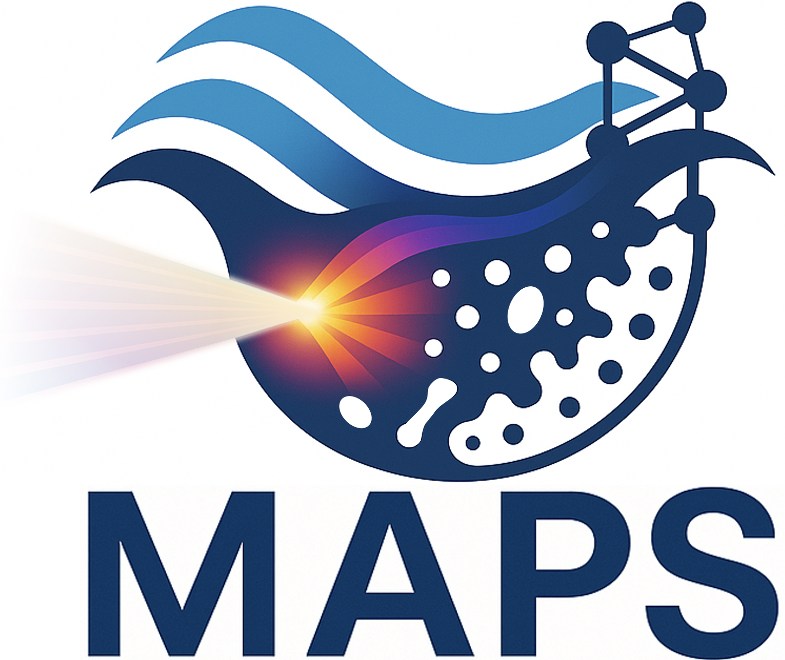
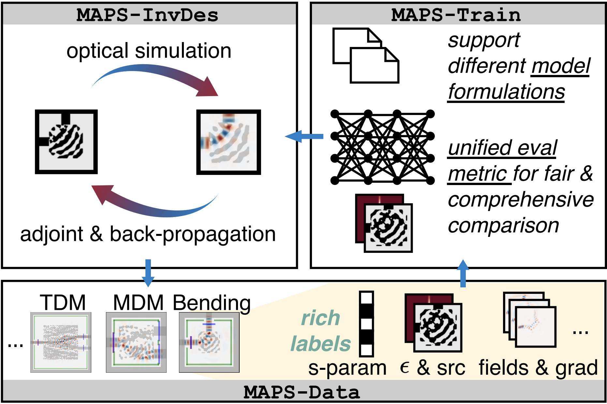
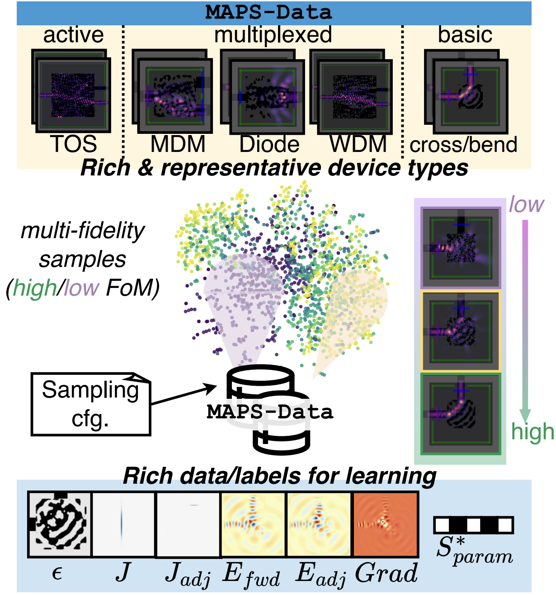
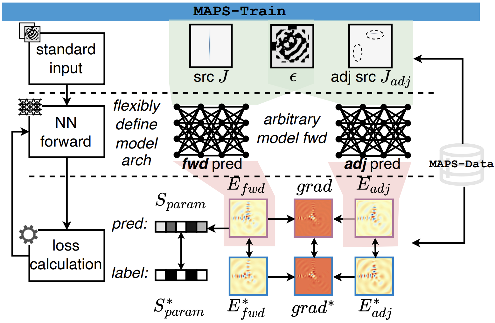
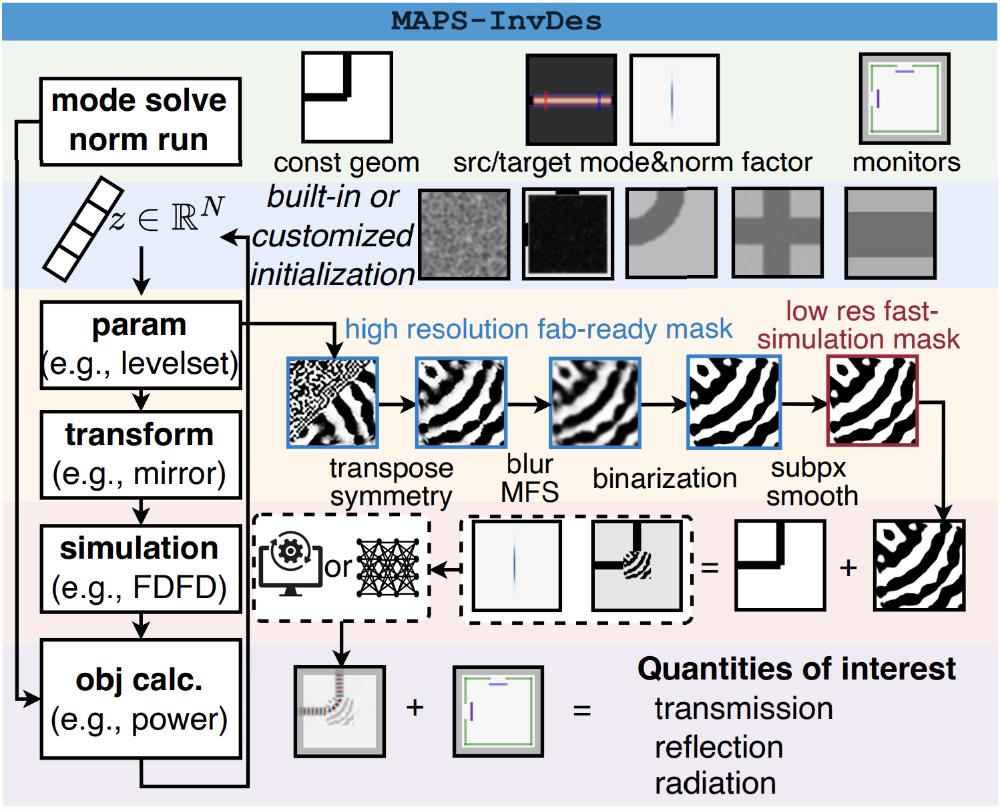

# MAPS: Multi-Fidelity AI-Augmented Photonic Simulation and Inverse Design Infrastructure

By Pingchuan Ma, Zhengqi Gao, Meng Zhang, Haoyu Yang, Mark Ren, Rena Huang, Duane S. Boning, and [Jiaqi Gu<sup>†</sup>](https://scopex-asu.github.io/index.html).

This repo is the official implementation of ["MAPS: Multi-Fidelity AI-Augmented Photonic Simulation and Inverse Design Infrastructure"](https://arxiv.org/abs/2503.01046) (DATE 2025)

<p align="center">
  
</p>

## News
[2026/11/20] Released v0.0.5
- **Public `fdtdx` 3D Adjoint Support**: Added `thirdparty/fdtdx` compatibility and adjoint source extensions on top of public [`fdtdx`](https://github.com/ymahlau/fdtdx) (pinned commit [`77b4bc52`](https://github.com/ymahlau/fdtdx/commit/77b4bc523a8e98cb7dd388e99481a0000f71dd4d)) *(Note: do not install the PyPI `fdtdx==0.6.2` release; see [Installation](#installation).)*
- **Broadband & Sparse 3D FDTD**: Added Chebyshev broadband mode sources, factored Chebyshev broadband adjoints, Tidy3D-style tilted/defocused Gaussian beam sources (`GaussianPlaneSourceTidy3d`), and memory-efficient sparse phasor recording (`MAPS_SPARSE_PHASOR=1`).
- **Physical Power & Observable Normalization**: Unified SI surface-area quadrature and discrete pulse-spectrum normalization across 2D FDFD and 3D FDTD-X (`FluxObjective`, `EigenmodeObjective`, `SMatrixObjective`, cross-axis monitors, and PEC/PMC symmetry unfolding).
- **Metasurface & Near-to-Far Workflows**: Added `Metasurface` inverse design and exact/accelerated Stratton-Chu & angular-spectrum near-to-far projection (`core/nearfield/`, `examples/nearfield/`).
- **Manufacturing & Variation Robustness**: Added Tidy3D-style differentiable `ErosionDilationPenalty` with simulation-context halo padding, stochastic fabrication/source variation optimization (`core/invdes/variation/`), and CUDA `gpu_subpixel` rasterization (`box`, `circle`, `digital_y_branch*`).
- **Run Management, Visualization, Docs & CI**: Added `OptimizationRunManager`, Tidy3D 3D field visualization exports (`core/visualization/`), MkDocs technical documentation (`docs/`), and structured `pytest` regression suites (`tests/`).

[2026/07/05] Released v0.0.4
- Integrate fdtdx(https://github.com/ymahlau/fdtdx) solver to enable GPU-accelerated 3D FDTD and (broadband) adjoint optimization. *Currently depend on private internal fdtdx-adjoint library to support adjoint 3D FDTD inverse design*
- Support reduced-degree-of-freedom FEM-based differentiable/adjoint HEAT solver to enable thermo-optical co-simulation and inverse design.
- Add various 2.5D/3D Si/SiN device inverse design examples
- Use Tidy3d for uniform/nonuniform Autogrid discretization/rasterization. fdtdx also supports rectilinear grid simulation.
- Major update to Grid system: (Native optical grid, Native heat grid, Export uniform grid)
- Major update to plot function that supports 3D view, multiple design region, grad plot.
- Support differentiable 3D extrusion with certain sidewall angle from 2D geometry.
- Support callback function in InvDes module.
- Levelset parametrization uses SubpixelSmoothedProjection instead of Heaviside
- Support 3D to 2.5D effective index simulation.
- Support various NCG optimizers.
- Support nonuniform rectilinear grid 2d FDFD with precondition support, native grid objective.
- Support polygon and edgebox for shape optimization

[2025/11/05] Released v0.0.3
- Integrate [pydiso](https://github.com/simpeg/pydiso) solver to enable reusing matrix symbolic factorization for speedup. For the same polarization (e.g., Ez), there is only one solver instance as all matrices have the same sparse structure to avoid memory explosion.
- Add EtchMMI device with rectangles in the design region.
- Add continuous geometry parameterization. Support rectangles (box) with gradient calculation.
- Support exp2 sharpness scheduler
- Add video generation based on steady-state field solution
- Add differentiable morphology operator in reparametrization
- Add gaussian-smoothed linear interpolation in levelset
- Add Tidy3d for fast high-resolution epsilon map building, add cynlinder geometry.
- Add LM optimizer
- Change mdm behavior as MUX+converter
- Support wdm_SiN, mdm_SiN
- [important] remove levelset knot normalization


[2025/10/19] Released v0.0.2
- MAPS-InvDes supported. Levelset-based photonic device inverse design
- MAPS-Data supported. Photonic simulation dataset generation, including forward fields, adjoint fields, S parameters, etc.
- MAPS-train supported. Framework for AI model training for optical simulation prediction.


## Table of Contents

- [Introduction](#introduction)
- [Interactive Runtime Architecture](#interactive-runtime-architecture)
- [Folder Structure](#folder-structure)
- [Prerequisites](#prerequisites)
- [Installation](#installation)
- [Usage](#usage)


## Introduction

Inverse design has emerged as a transformative approach for photonic device optimization, enabling the exploration of high-dimensional, non-intuitive design spaces to create ultra-compact devices and advance photonic integrated circuits (PICs) in computing and interconnects. However, practical challenges, such as suboptimal device performance, limited manufacturability, high sensitivity to variations, computational inefficiency, and lack of interpretability, have hindered its adoption in commercial hardware. Recent advancements in AI-assisted photonic simulation and design offer transformative potential, accelerating simulations and design generation by orders of magnitude over traditional numerical methods. Despite these breakthroughs, the lack of an open-source, standardized infrastructure and evaluation benchmark limits accessibility and cross-disciplinary collaboration. To address this, we introduce **MAPS**, a multi-fidelity AI-augmented photonic simulation and inverse design infrastructure designed to bridge this gap. MAPS features three synergistic components: (1) **MAPS-Data**: A dataset acquisition framework for generating multi-fidelity, richly labeled devices, providing high-quality data for AI-for-optics research. (2) **MAPS-Train**: A flexible AI-for-photonics training framework offering a hierarchical data loading pipeline, customizable model construction, support for data- and physics-driven losses, and comprehensive evaluations. (3) **MAPS-InvDes**: An advanced adjoint inverse design toolkit that abstracts complex physics but exposes flexible optimization steps, integrates pre-trained AI models, and incorporates fabrication variation models. This infrastructure MAPS provides a unified, open-source platform for developing, benchmarking, and advancing AI-assisted photonic design workflows, accelerating innovation in photonic hardware optimization and scientific machine learning.

<p align="center">
  

</p>

In **MAPS-Data**, users can sample photonic device data using customized sampling strategy.
<p align="center">
  
</p>

**MAPS-Train** supports AI model training using MAPS-Data as datasets for AI-assisted photonic device simulation and inverse design. It supports standardized input,
flexible neural network model definition, and diverse datadriven/physics-driven loss function calculation.
<p align="center">
  
</p>

**MAPS-InvDes** is a framework with full support of simulation and adjoint-based inverse design. Users can use the AI models trained from MAPS-Train to accelerate inverse design.
<p align="center">
  
</p>

## Interactive Runtime Architecture

Explore the code-backed runtime architecture of MAPS (generated with [Archify](https://github.com/tt-a1i/archify)):

- **[Interactive MAPS Runtime Architecture (`docs/architecture/maps-runtime.architecture.html`)](docs/architecture/maps-runtime.architecture.html)** — standalone interactive HTML diagram (download or open directly in a browser; no extra install needed). Includes **4 guided views** (*MAPS-InvDes Loop*, *2D/3D Multi-Physics Solvers*, *MAPS-Data & MAPS-Train*, *Fabrication & Variation*), upstream/downstream reach tracing, source file/line inspection, light/dark themes, and PNG/SVG/WebM export.
- **[Architecture Overview (`docs/architecture/overview.md`)](docs/architecture/overview.md)** · **[Typed Archify Spec (`docs/architecture/maps-runtime.architecture.json`)](docs/architecture/maps-runtime.architecture.json)**

## Folder Structure
- **configs/**: Configuration files for simulation, neural surrogate training, and variation workflows.
- **core/**: Core codebase of MAPS.
  - **fdfd/**: Differentiable 2D uniform & rectilinear FDFD solver.
  - **fdtd/**: Differentiable 3D FDTD-X wrapper and broadband adjoint solver.
  - **heat/**: Differentiable FEM thermo-optic heat solver.
  - **nearfield/**: 2D/3D near-to-far projection (Stratton-Chu & angular spectrum).
  - **invdes/**: MAPS-InvDes framework: parametrization, objectives, variation, devices, and examples.
  - **inv_litho/**: Differentiable inverse lithography models.
  - **train/**: MAPS-Train framework: neural operator models, datasets, losses, and trainers.
  - **visualization/**: Tidy3D and cross-section field visualization utilities.
- **data/**: MAPS-Data dataset generation scripts (`data/fdfd/`, `data/fdtd/`).
- **docs/**: Technical documentation, scientific conventions, and API references.
- **examples/**: Interactive near-field / metasurface walkthrough notebooks.
- **gpu_subpixel/**: CUDA-accelerated exact geometric subpixel rasterizer.
- **scripts/**: Experiment launching scripts.
- **tests/**: Structured `pytest` unit, integration, gradient, numerical, and FDTD-X test suites.
- **thirdparty/**: Bundled extensions (`thirdparty/ceviche/`, `thirdparty/fdtdx/`).

## Prerequisites

- Linux with NVIDIA GPU driver and CUDA 12.8 runtime
- Python 3.11 (`3.11.10` validated)
- Conda / Miniforge (bootstrapped automatically by `install.sh` if absent)
- [`pyutility`](https://github.com/JeremieMelo/pyutility) (`pyutils`, installed automatically by `install.sh`)
- For 3D FDTD workflows: upstream [`fdtdx`](https://github.com/ymahlau/fdtdx) at **exact commit `77b4bc523a8e98cb7dd388e99481a0000f71dd4d`** (see warning below)

## Installation

Clone the repository:
```bash
git clone https://github.com/ScopeX-ASU/MAPS.git
cd MAPS
```

1. **Default installation (2D FDFD, dataset generation, neural surrogate training, and GDS layout tools)**:
```bash
bash install.sh
python verify_install.py
```

2. **Full 3D installation (adds JAX, pinned `fdtdx`, and thermo-optic `jax-fem` heat solver)**:
```bash
INSTALL_OPTIONAL_3D=1 bash install.sh
python verify_install.py --require-optional-3d
```

> [!IMPORTANT]
> **`fdtdx` Commit Requirement (Do NOT install PyPI `fdtdx==0.6.2`)**
>
> MAPS v0.0.5 requires a specific post-`0.6.2` commit of [`ymahlau/fdtdx`](https://github.com/ymahlau/fdtdx) (`77b4bc523a8e98cb7dd388e99481a0000f71dd4d`, 68 commits ahead of tag `v0.6.2`) for rectilinear grids, generalized mode-overlap detectors, and symmetry fixes. Because upstream `pyproject.toml` at that commit still reports version `0.6.2`, `pip list` will display `0.6.2`, **but installing `pip install fdtdx==0.6.2` from PyPI will fail**.
>
> Always install `fdtdx` via `INSTALL_OPTIONAL_3D=1 bash install.sh` or directly from the pinned commit:
> ```bash
> python -m pip install --force-reinstall --no-deps \
>   "fdtdx @ git+https://github.com/ymahlau/fdtdx.git@77b4bc523a8e98cb7dd388e99481a0000f71dd4d"
> ```
> Run `python verify_install.py --require-optional-3d` to verify the installed Git commit provenance. See [README_install.md](README_install.md) for full dependency details.

## Usage
1. run examples of inverse design, e.g., waveguide bending
```
python core/invdes/examples/bending.py
```
or
```
python scripts/device/train.py
```
For 3D:
```
unset LD_LIBRARY_PATH;
export CUDA_VISIBLE_DEVICES=0 python core/invdes/examples/bending_3d.py
```
If broadband 3D FDTD adjoint solve is needed (experimental)
```
unset LD_LIBRARY_PATH;
export CUDA_VISIBLE_DEVICES=0 MAPS_ENABLE_BROADBAND_ADJOINT=1 python core/invdes/examples/bending_3d.py
```
2. generate photonic device simulation datasets, e.g., generate 8 bending devices with perturbation applied
```
python data/fdfd/dataset_generation_launcher.py \
  --device-name bending \
  --num-devices 8 \
  --num-gpus 4 \
  --include-perturb
```

3. train AI model on device dataset for forward Maxwell Equation prediction task, e.g., Fourier neural operator on bending forward Ez field prediction.
```
python scripts/nn/fno/train_fwd_model.py
```


# Citing MAPS
```
@inproceedings{ma2025maps,
      title={{MAPS: Multi-Fidelity AI-Augmented Photonic Simulation and Inverse Design Infrastructure}},
      author={Pingchuan Ma and Zhengqi Gao and Meng Zhang and Haoyu Yang and Mark Ren and Rena Huang and Duane S. Boning and Jiaqi Gu},
      year={2025},
      booktitle={Design, Automation and Test in Europe Conference (DATE)},
      url={https://arxiv.org/abs/2503.01046},
}
```
```
Pingchuan Ma, Zhengqi Gao, Meng Zhang, Haoyu Yang, Mark Ren, Rena Huang, Duane S. Boning and Jiaqi Gu, "MAPS: Multi-Fidelity AI-Augmented Photonic Simulation and Inverse Design Infrastructure," Design, Automation and Test in Europe Conference (DATE), Lyon, France, Mar. 31 - Apr. 02, 2025.
```
